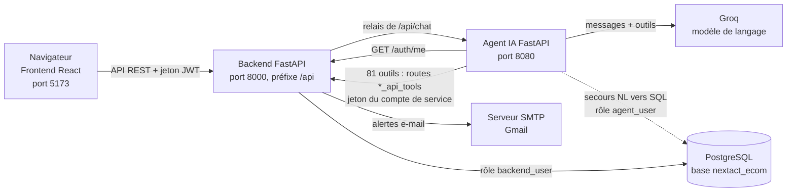
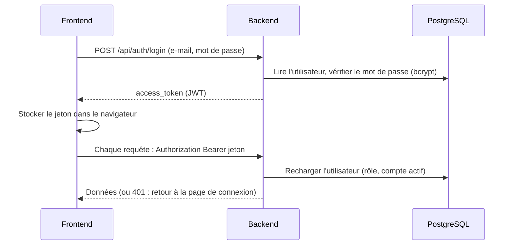
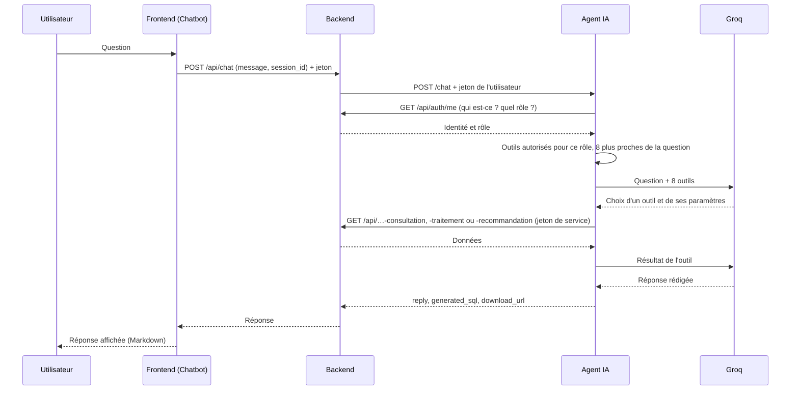

# Architecture globale

Cette page donne la **vue d'ensemble** du projet NextAct : de quoi il est fait, comment les quatre parties communiquent, et quelles valeurs de configuration doivent rester identiques d'un endroit à l'autre. Chaque partie est ensuite détaillée dans son propre dossier.

- Installer le projet : [06-guide-installation.md](06-guide-installation.md)
- Retour à l'accueil : [README.md](README.md)

---

## 1. Vue d'ensemble

NextAct est une application **ERP de reporting** (stock, ventes, achats, fournisseurs, clients, devis, paiements, remboursements) avec :

- des **tableaux de bord et des rapports** par domaine, dans un navigateur ;
- un **assistant IA** qui répond en langage naturel aux questions sur les données et génère des exports ;
- des **alertes métier par e-mail** ;
- un **contrôle d'accès par rôle** (un administrateur et huit rôles de domaine).

## 2. Les quatre parties

| Partie | Rôle | Technologies | Port | Documentation |
|---|---|---|:-:|---|
| **Base de données** | Stocke l'ERP et expose des vues et fonctions de reporting | PostgreSQL, pgAdmin 4 | `5432` | [`02-base-de-donnees/`](02-base-de-donnees/README.md) |
| **Backend** | API REST : authentification, rapports, exports, alertes e-mail, relais vers l'agent | FastAPI, SQLAlchemy 2.x, JWT, APScheduler | `8000` | [`03-backend/`](03-backend/README.md) |
| **Frontend** | Interface web : dashboard, 8 rapports, administration, chatbot | React 19, Vite, Tailwind CSS v4, Recharts | `5173` | [`04-frontend/`](04-frontend/README.md) |
| **Agent IA** | Comprend les questions, choisit parmi 81 outils, rédige les réponses | FastAPI, Groq (`qwen/qwen3.8-27b`), modèle d'embeddings local | `8080` | [`05-ai-agent/`](05-ai-agent/README.md) |

Les dossiers de code sources correspondants sont, d'après la documentation de chaque partie : `nextact-backend-only/` (backend), `nextact-frontend-only/` (frontend) et `ai-agent/` (agent IA).

## 3. La base de données : deux schémas, trois couches

La base `nextact_ecom` contient **deux schémas** :

| Schéma | Contenu | Détail |
|---|---|---|
| `public` | Les 17 tables de l'ERP + la table `users` | [tables.md](02-base-de-donnees/tables.md) |
| `agent_reporting` | 27 vues, 44 fonctions et 2 tables propres (`alert_notifications_sent`, `file_exports`) | [vues.md](02-base-de-donnees/vues.md), [fonctions.md](02-base-de-donnees/fonctions.md) |

Le schéma `agent_reporting` est organisé en **trois couches**, que l'on retrouve **identiques** dans le backend et dans l'agent IA :

| Couche | Rôle | Base de données | Backend | Agent IA |
|---|---|---|---|---|
| **Consultation** | Lire, rechercher, lister | Vues `v_*` | Classes `*ConsultationRepository`, routes `*-consultation` | Outils de consultation |
| **Traitement** | Calculer : totaux, statistiques, classements | Fonctions `fn_*` | Classes `*TraitementRepository`, routes `*-traitement` | Outils de traitement |
| **Recommandation** | Détecter ce qui demande une action | Fonctions `fn_*` | Classes `*RecommandationRepository`, routes `*-recommandation` | Outils de recommandation |

À côté, les **pages de rapport du frontend** utilisent les classes `*AnalyticsRepository` et un endpoint `/api/<domaine>/report` par domaine.

### Deux rôles PostgreSQL

| Rôle | Utilisé par | Droits |
|---|---|---|
| `backend_user` | Le backend | Lecture seule sur les 17 tables ERP ; lecture et écriture sur `users` ; lecture et exécution sur `agent_reporting` ; écriture sur `file_exports` et insertion dans `alert_notifications_sent` |
| `agent_user` | L'agent IA (secours NL→SQL uniquement) | Lecture des vues et exécution des fonctions de `agent_reporting`. **Aucun accès** aux tables brutes de `public` |

Le backend n'écrit donc que dans **trois tables** : `users`, `file_exports` et `alert_notifications_sent`.

## 4. Les parcours principaux

### 4.1 Se connecter

Le jeton ne contient **pas** le rôle : il est relu en base à chaque requête. Un changement de rôle ou la désactivation d'un compte est donc **immédiat**.

### 4.2 Consulter un rapport

1. L'utilisateur ouvre une page de rapport (par exemple « Stock ») et choisit une période.
2. Le frontend appelle `GET /api/stock/report?start_date=…&end_date=…` avec son jeton.
3. Le backend vérifie le jeton, puis la classe `*AnalyticsRepository` interroge les vues et fonctions de `agent_reporting`.
4. Le frontend affiche les chiffres et graphiques ; l'export **PDF** de la page est fabriqué dans le navigateur.

### 4.3 Poser une question à l'assistant IA

Points à retenir :

- l'agent **revérifie** l'identité de l'utilisateur auprès du backend ;
- l'agent applique **lui-même** les droits du rôle (outils autorisés, type de rapport exportable) ;
- tous les outils appellent le backend avec le **jeton du compte de service** de l'agent (rôle `admin`), pas avec celui de l'utilisateur ;
- si aucun outil ne convient, l'agent peut générer une requête SQL en lecture seule, très encadrée (le « secours NL→SQL », seul cas où l'agent interroge directement PostgreSQL).

Détail : [`05-ai-agent/architecture-agent.md`](05-ai-agent/architecture-agent.md).

### 4.4 Exporter un fichier (xlsx, csv, pdf)

1. L'utilisateur demande par exemple *« télécharge les ventes de juillet en Excel »*.
2. L'agent déclenche l'outil `generate_report_file`, qui appelle `POST /api/reports/export` du backend (après avoir vérifié que le type de rapport est autorisé pour le rôle).
3. Le backend génère le fichier dans son dossier d'exports (`temp_exports` par défaut), l'enregistre dans la table `file_exports` et renvoie un lien `download_url`.
4. Le chatbot propose un bouton « Télécharger le fichier » : le fichier est récupéré avec le jeton de l'utilisateur (`GET /api/reports/download/<fichier>`).
5. Un export **expire au bout de 48 heures** (réponse `410`) ; une tâche planifiée supprime les exports expirés.

### 4.5 Alertes par e-mail

Le backend lance, au démarrage, **deux tâches planifiées** (APScheduler) :

- les **alertes métier** : toutes les `ALERT_CHECK_INTERVAL_MINUTES` minutes (60 par défaut), elles détectent les situations à signaler et les envoient par e-mail via SMTP. La table `alert_notifications_sent` mémorise ce qui a déjà été envoyé, pour ne pas renvoyer deux fois la même alerte ;
- le **nettoyage** des exports expirés.

## 5. Rôles et droits d'accès

L'application distingue **9 rôles** : `admin` et 8 rôles de domaine. Chaque rôle de domaine donne accès à **un seul domaine** (une page de rapport, un type d'export, quelques vues et outils).

| Rôle | Page de rapport (frontend) | Type d'export |
|---|---|---|
| `admin` | Toutes, plus le dashboard et la gestion des utilisateurs | Tous |
| `user_stock` | `/rapport-stock` | `stock` |
| `user_sales` | `/rapport-ventes` | `sales` |
| `user_purchases` | `/rapport-purchases` | `purchases` |
| `user_suppliers` | `/rapport-suppliers` | `suppliers` |
| `user_devis` | `/rapport-devis` | `devis` |
| `user_payments` | `/rapport-paiements` | `payments` |
| `user_clients` | `/clients-report` | `clients` |
| `user_refunds` | `/rapport-remboursements` | `refunds` |

Le rôle est stocké dans `users.role` (valeurs en **majuscules** dans PostgreSQL, par exemple `USER_STOCK`) et exposé par l'API en **minuscules** (`user_stock`).

### Où les droits sont appliqués

| Où | Ce qui est contrôlé | Fichiers |
|---|---|---|
| **Frontend** | Pages et menus visibles. C'est de l'**ergonomie** : elle ne protège rien à elle seule | `App.jsx`, `Sidebar.jsx`, `RoleWelcome.jsx`, `AdminUsersPage.jsx` |
| **Backend** | Administration des utilisateurs (rôle `admin`) et type de rapport exportable. Les routes de rapport exigent un jeton valide mais, d'après la documentation du backend, **ne contrôlent pas le rôle** | `core/role_permissions.py`, `core/dependencies.py` |
| **Agent IA** | Outils autorisés, vues du secours NL→SQL, type de rapport exportable | `tools/role_permissions.py` |

> ⚠️ **La matrice des rôles existe en trois exemplaires** (frontend, backend, agent). Si vous ajoutez un rôle, une page, un type de rapport ou un outil, **modifiez les trois**. Voir [`05-ai-agent/tools-et-schemas.md`](05-ai-agent/tools-et-schemas.md) (§5) et [`04-frontend/structure-projet.md`](04-frontend/structure-projet.md) (§9).

## 6. Valeurs à garder cohérentes entre les parties

Plusieurs valeurs sont saisies à un endroit et réutilisées ailleurs. Une erreur de recopie est la cause la plus fréquente de panne à l'installation.

| Valeur | Définie / choisie | Doit être identique dans |
|---|---|---|
| Nom de la base `nextact_ecom` | Création de la base (`02-base-de-donnees`) | `DB_NAME` du backend **et** de l'agent |
| Mot de passe de `agent_user` | Étape 0 du SQL (information n° 1) | `DB_PASS` de l'agent |
| Mot de passe de `backend_user` | Étape 0 du SQL (information n° 2) | `DB_PASS` du backend |
| E-mail du compte « AI agent » | Étape 0 du SQL (information n° 3) | `AGENT_SERVICE_EMAIL` de l'agent (facultatif aussi dans le backend) |
| Mot de passe du compte « AI agent » | Étape 0 du SQL (information n° 4) | `AGENT_SERVICE_PASSWORD` de l'agent |
| E-mail et mot de passe de l'administrateur | Étape 0 du SQL (informations n° 6 et 7) | Connexion à l'application |
| URL du backend vue par l'agent | — | `BACKEND_URL` de l'agent : `http://localhost:8000/api` |
| URL de l'agent vue par le backend | — | `AGENT_API_URL` du backend : `http://localhost:8080` (valeur par défaut) |
| URL du backend vue par le frontend | — | `VITE_API_URL` du frontend : `http://localhost:8000/api` |
| Origine du frontend autorisée | Backend (`main.py`, CORS) | `http://localhost:5173` uniquement |
| Clé de signature des jetons | `SECRET_KEY` du backend | Backend seulement (la changer déconnecte tous les utilisateurs) |

### Ports

| Service | Adresse | Interface de test |
|---|---|---|
| PostgreSQL | `localhost:5432` | pgAdmin 4 |
| Backend | `http://localhost:8000` | `/docs` (Swagger) |
| Agent IA | `http://127.0.0.1:8080` | `/docs` (Swagger) |
| Frontend | `http://localhost:5173` | Le navigateur |

## 7. Sécurité : vue d'ensemble

La sécurité repose sur **plusieurs barrières successives** :

1. **PostgreSQL** : deux rôles distincts, `agent_user` sans accès aux tables brutes, `backend_user` en lecture seule sur l'ERP ;
2. **Backend** : jetons JWT, mots de passe chiffrés (bcrypt), rôle relu en base à chaque requête ;
3. **Agent IA** : identité revérifiée, outils filtrés par rôle, contrôle à l'exécution, garde-fous SQL ;
4. **Frontend** : gardes de route par rôle (ergonomie).

Points d'attention connus, à traiter avant toute mise en production :

| Constat | Source |
|---|---|
| `POST /api/user/reset-password` est public, sans jeton de vérification : n'importe qui peut changer le mot de passe d'un e-mail connu | [`03-backend/authentification.md`](03-backend/authentification.md) (§8) |
| Les routers `dashboard`, `sales` et `refunds` du backend n'exigent aucune authentification | [`03-backend/authentification.md`](03-backend/authentification.md) (§8) |
| Aucun router de rapport ne vérifie le rôle : un utilisateur connecté peut appeler les routes des autres domaines | [`03-backend/authentification.md`](03-backend/authentification.md) (§8) |
| Le compte de service de l'agent est `admin` : le backend ne voit pas qui pose la question, c'est l'agent qui applique les droits | [`05-ai-agent/securite.md`](05-ai-agent/securite.md) (§5-D) |
| Le contrôle des vues du secours NL→SQL est contournable par une jointure à virgule, et le délai d'exécution est réglé sur près de 6 jours | [`05-ai-agent/securite.md`](05-ai-agent/securite.md) (§5-A, §5-B) |
| Le jeton est conservé dans le navigateur (`localStorage`), et le chatbot ignore `VITE_API_URL` (adresse codée en dur) | [`04-frontend/README.md`](04-frontend/README.md) (§5) |
| Le CORS n'autorise que `http://localhost:5173` : à rendre configurable pour la production | [`03-backend/configuration.md`](03-backend/configuration.md) (§6) |
| Une durée de vie de jeton très longue (`ACCESS_TOKEN_EXPIRE_MINUTES`) laisse un jeton volé valide très longtemps | [`03-backend/configuration.md`](03-backend/configuration.md) (§3) |

## 8. Pour aller plus loin

| Je veux… | Je lis… |
|---|---|
| Installer tout le projet | [06-guide-installation.md](06-guide-installation.md) |
| Comprendre une table, une vue ou une fonction SQL | [`02-base-de-donnees/`](02-base-de-donnees/README.md) |
| Connaître les routes de l'API ou la structure du backend | [`03-backend/routes-api.md`](03-backend/routes-api.md), [`structure-projet.md`](03-backend/structure-projet.md) |
| Comprendre une page ou un composant React | [`04-frontend/pages-et-composants.md`](04-frontend/pages-et-composants.md) |
| Comprendre comment l'agent raisonne | [`05-ai-agent/architecture-agent.md`](05-ai-agent/architecture-agent.md) |
| Ajouter un outil à l'agent | [`05-ai-agent/tools-et-schemas.md`](05-ai-agent/tools-et-schemas.md) (§7) |
