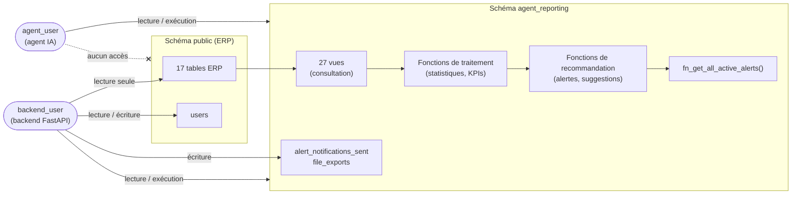
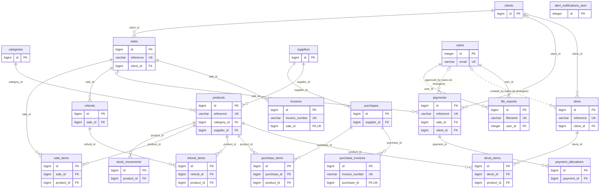

# Schéma des relations (ERD) et architecture

## 1. Architecture générale

Les trois couches du schéma `agent_reporting` :

| Couche | Rôle | Dossier du projet |
|---|---|---|
| **consultation** | Vues « détail » : jointures déjà faites, montants nets calculés | `*/consultation/` et `views.sql` |
| **traitement** | Fonctions de calcul : statistiques, agrégations par période, classements | `*/traitement/` |
| **recommandation** | Fonctions qui détectent les situations à traiter (clients à relancer, devis qui expirent, ruptures…) | `*/recommendation/` ou `*/recommandation/` |

## 2. Diagramme entité-relation

Seules les colonnes clés (clé primaire **PK**, clé étrangère **FK**, unique **UK**) sont représentées. Toutes les colonnes sont détaillées dans [tables.md](tables.md).

## 3. Liste des relations

| Table parent | Table enfant | Colonne (enfant) | Suppression du parent |
|---|---|---|---|
| `categories` | `products` | `category_id` | cascade |
| `clients` | `devis` | `client_id` | set null |
| `clients` | `payments` | `client_id` | set null |
| `clients` | `sales` | `client_id` | cascade |
| `devis` | `devis_items` | `devis_id` | cascade |
| `payments` | `payment_allocations` | `payment_id` | cascade |
| `products` | `devis_items` | `product_id` | cascade |
| `products` | `purchase_items` | `product_id` | cascade |
| `products` | `refund_items` | `product_id` | cascade |
| `products` | `sale_items` | `product_id` | cascade |
| `products` | `stock_movements` | `product_id` | cascade |
| `purchases` | `purchase_invoices` | `purchase_id` | cascade |
| `purchases` | `purchase_items` | `purchase_id` | cascade |
| `refunds` | `refund_items` | `refund_id` | cascade |
| `sales` | `invoices` | `sale_id` | cascade |
| `sales` | `payments` | `sale_id` | set null |
| `sales` | `refunds` | `sale_id` | cascade |
| `sales` | `sale_items` | `sale_id` | cascade |
| `suppliers` | `products` | `supplier_id` | cascade |
| `suppliers` | `purchases` | `supplier_id` | cascade |
| `users` | `file_exports` | `user_id` | cascade |
| `users` | `devis` | `created_by` | *(pas de clé étrangère)* |
| `users` | `payments` | `approved_by` | *(pas de clé étrangère)* |
| `users` | `file_exports` | `user_id` | supprime aussi ses exports (`cascade`) |

Liens logiques (non déclarés comme clés étrangères) :

- `payment_allocations.payable_type` + `payable_id` : désignent l'objet payé (la vente) ;
- `stock_movements.source` + `reference_id` : désignent l'achat, la vente ou le remboursement à l'origine du mouvement.

## 4. Lecture rapide du modèle

- **Ventes** : `clients` → `sales` → `sale_items` → `products`. Un paiement (`payments`) est affecté à une vente via `payment_allocations`. Un remboursement (`refunds` / `refund_items`) se rattache à une vente.
- **Achats** : `suppliers` → `purchases` → `purchase_items` → `products`.
- **Devis** : `clients` → `devis` → `devis_items` → `products`.
- **Stock** : chaque achat, vente ou remboursement génère une ligne dans `stock_movements`.
