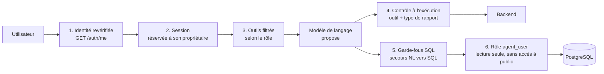

# Sécurité de l'agent IA

Cette page décrit **comment l'agent est protégé**, ce qui a été vérifié, et les **points faibles connus** avec le correctif conseillé pour chacun.

- Fonctionnement général : [architecture-agent.md](architecture-agent.md)
- Droits par rôle : [tools-et-schemas.md](tools-et-schemas.md)
- Instructions du modèle : [system-prompt.md](system-prompt.md)

---

## 1. Principe : ne jamais faire confiance au modèle

Un modèle de langage peut se tromper, être manipulé par une question habile, ou « halluciner ». L'agent est donc conçu ainsi :

> **Le modèle propose, le code décide.**

Le modèle peut seulement *demander* l'exécution d'un outil ou *proposer* une requête SQL. Tout est contrôlé par du code classique **avant** exécution, et la base de données applique elle-même des limites en dernier recours : c'est la **défense en profondeur** (plusieurs barrières successives, chacune suffisant à arrêter un abus que la précédente aurait laissé passer).



## 2. Les protections en place

| # | Protection | Où | Ce qu'elle empêche |
|---|---|---|---|
| 1 | **Identité revérifiée à chaque requête** : le jeton est contrôlé auprès du backend (`GET /auth/me`), même s'il a déjà été validé en amont ; compte désactivé = refus | `agent/user_context.py` | Utiliser un faux jeton, un jeton expiré, ou un compte désactivé |
| 2 | **Session réservée à son propriétaire** : un `session_id` est lié au premier utilisateur qui l'utilise ; tout autre reçoit une erreur `403` | `agent/memory.py` | Lire l'historique de conversation d'un autre utilisateur |
| 3 | **Outils filtrés par rôle** avant d'être proposés au modèle ; rôle inconnu = aucun outil (*fail-closed*) | `tools/role_permissions.py`, `orchestrator.py` | Que le modèle « voie » des outils hors du domaine de l'utilisateur |
| 4 | **Contrôle à l'exécution** : même si le modèle demande un outil interdit, `execute_tool_call` le refuse. Pour l'export, le **type de rapport** doit appartenir au domaine du rôle | `agent/tool_executor.py` | Qu'un modèle manipulé exécute un outil interdit, ou exporte les paiements sans y avoir droit |
| 5 | **Garde-fous du secours NL→SQL** : `SELECT` uniquement, mots-clés dangereux interdits, ni `;` ni commentaires, vues limitées au rôle, 50 lignes maximum | `agent/nl_to_sql_fallback.py` | Écriture ou suppression de données, requêtes empilées, lecture de vues hors rôle |
| 6 | **Rôle PostgreSQL `agent_user`** : lecture seule sur les vues de `agent_reporting`, **aucun accès au schéma `public`** (tables brutes) | Base de données (documentation 1) | Écrire dans la base ou lire les tables brutes, *même si* tous les garde-fous précédents étaient contournés |
| 7 | **Données traitées comme des données** : le modèle reçoit la consigne de ne jamais suivre d'instructions contenues dans les résultats | `orchestrator.py` | L'injection de consignes via le contenu de la base |
| 8 | **Secrets hors du code** : clés et mots de passe dans `.env`, jamais dans les fichiers du projet | `main.py`, `db/connection.py` | Fuite de secrets dans le dépôt de code |

Autres choix de conception :

- l'agent n'écoute que sur **`127.0.0.1`** (la machine locale) : il n'est pas exposé directement au réseau ;
- les messages de refus indiquent **pourquoi** (périmètre du rôle) sans révéler le détail des données ;
- le jeton de service est protégé par un verrou : pas de demandes simultanées en double.

## 3. Menaces et réponses

| Menace | Réponse de l'agent |
|---|---|
| Quelqu'un appelle `/chat` sans jeton | Erreur `422` (en-tête obligatoire manquant) |
| Jeton invalide, expiré, ou compte désactivé | Erreur `401` |
| Backend injoignable pendant la vérification | Erreur `502` : refus par défaut |
| Un utilisateur réutilise le `session_id` d'un autre | Erreur `403` |
| Un utilisateur « paiements » interroge le stock | Outil non proposé ; message « Selon tes permissions… » |
| Le modèle demande malgré tout un outil interdit | Refusé à l'exécution : « Vous n'avez pas la permission… » |
| Export d'un type de rapport hors du rôle | Refusé : « Vous n'avez pas la permission d'exporter ce type de rapport. » |
| « Supprime tous les clients » (suppression) | Requête non `SELECT` rejetée ; de toute façon `agent_user` n'a aucun droit d'écriture |
| Requêtes empilées (`...; DROP TABLE ...`) | Rejetées (mot-clé interdit, caractère `;`) |
| Lecture des tables brutes (`public.clients`) | Rejetée par le garde-fou 4, **et** refusée par PostgreSQL (`permission denied for schema public`) |
| Texte malveillant dans une donnée (« ignore tes règles… ») | Traité comme une donnée, jamais comme une instruction |

## 4. Ce qui a été vérifié

Lors de la rédaction de cette documentation, les garde-fous du secours NL→SQL ont été **exécutés** sur une base de test PostgreSQL 16 (avec la structure décrite dans la documentation 1), avec le rôle `agent_user`. Le modèle a été remplacé par des requêtes SQL simulées pour tester chaque cas :

| # | Requête simulée | Résultat |
|---|---|---|
| 1 | `SELECT` valide sur une vue autorisée | ✅ Exécutée, limite de 50 lignes ajoutée |
| 2 | Même requête avec `LIMIT 5` | ⚠️ Exécutée, mais la limite est **remplacée par 50** (voir §5-C) |
| 3 | `DELETE FROM ...` | ✅ Refusée (traitée comme hors périmètre) |
| 4 | `SELECT ...; DROP TABLE x` | ✅ Refusée (mot-clé interdit) |
| 5 | `SELECT * FROM public.clients` | ✅ Refusée (vue non autorisée) |
| 6 | Vue hors rôle via `JOIN` | ✅ Refusée |
| 7 | Vue hors rôle via une **jointure à virgule** (`FROM a, b`) | ⚠️ **Exécutée** (voir §5-A) |
| 8 | Table brute via jointure à virgule (`FROM v_clients, public.clients`) | ✅ Refusée **par PostgreSQL** : `permission denied for schema public` |
| 9 | Réponse du modèle `HORS_PERIMETRE` | ✅ Refusée (hors périmètre) |
| 10 | Requête contenant un commentaire SQL (`--`) | ✅ Refusée |

Le cas n° 8 illustre l'intérêt de la défense en profondeur : le garde-fou applicatif ne voit pas la table `public.clients`, mais la base de données la refuse.

> Le comportement de l'agent complet (modèle Groq, sélection sémantique, backend) n'a pas pu être exécuté dans cet environnement de rédaction : les tests ci-dessus portent sur les garde-fous SQL et sur le démarrage de l'application.

## 5. Limites connues et correctifs conseillés

### A. Contrôle des vues contournable par une jointure à virgule — priorité haute

**Constat.** Le garde-fou 4 ne contrôle que le premier nom qui suit `FROM` ou `JOIN`. Dans `FROM v_clients, v_payments`, seule `v_clients` est vérifiée : `v_payments` passe.

**Impact.** Un utilisateur au rôle limité (par exemple `user_clients`) pourrait, via le secours NL→SQL, lire une vue d'un **autre domaine** (par exemple les paiements). Les **tables brutes** restent protégées par PostgreSQL ; seul le contrôle *par rôle* est contournable. Le cas suppose que le modèle génère ce type de requête (par exemple après une question habile).

**Correctif conseillé.** Après le garde-fou 3 de `nl_to_sql_fallback.py`, rechercher **tous** les noms de vues ou de fonctions cités, et pas seulement ceux qui suivent `FROM`/`JOIN` :

```python
# Garde-fou 4 bis : toute vue/fonction citée, où que ce soit dans la requête
allowed_names = {v.lower() for v in available_views}
used_names = {
    m.lower()
    for m in re.findall(r'\b(?:agent_reporting\.)?((?:v|fn)_\w+)\b', sql_query, re.IGNORECASE)
}
unauthorized = used_names - allowed_names
if unauthorized:
    return {"error": "unauthorized_view", "view": sorted(unauthorized)[0]}
```

Cette logique a été vérifiée sur des exemples (jointure à virgule, sous-requête, requête normale). Pour une protection plus solide, utilisez un véritable analyseur SQL (par exemple la bibliothèque `sqlglot`) qui liste toutes les tables réellement lues.

### B. Délai d'exécution du secours beaucoup trop long — priorité haute

**Constat.** `QUERY_TIMEOUT_MS = 500000000` avec le commentaire « 5 secondes max ». La valeur est exprimée en **millisecondes** : 500 000 000 ms ≈ **5,8 jours**.

**Correctif.** `QUERY_TIMEOUT_MS = 5000` (5 secondes).

### C. La limite de lignes est remplacée même quand elle est plus basse — priorité faible

**Constat.** Le code remplace tout `LIMIT n` par `LIMIT 50`, même si `n` est inférieur : *« les 5 meilleurs clients »* peut renvoyer 50 lignes.

**Correctif** (plafonner au lieu de remplacer) :

```python
sql_query = re.sub(
    r'LIMIT\s+(\d+)',
    lambda m: f"LIMIT {min(int(m.group(1)), MAX_ROWS)}",
    sql_query,
    flags=re.IGNORECASE,
)
```

### D. Le compte de service est `ADMIN` — à connaître

**Constat.** Tous les outils appellent le backend avec le jeton du compte de service (rôle `ADMIN`). Le backend ne voit donc pas « qui » pose la question : c'est l'agent qui applique les droits (protections 3 et 4). Un défaut dans l'agent (ou une compromission de son compte) donnerait des droits d'administrateur sur les endpoints de données.

**Pistes.** Garder le contrôle des droits **aux deux endroits** (agent et backend) ; transmettre au backend l'identité de l'utilisateur final pour qu'il puisse appliquer ses propres règles ; protéger le mot de passe du compte de service comme un secret critique.

### E. Droits dupliqués à la main

Les droits de `tools/role_permissions.py` sont le **miroir manuel** de `core/role_permissions.py` du backend. Une divergence (outil ajouté d'un seul côté) crée un comportement incohérent. Pensez à modifier les deux fichiers ensemble.

### F. Journaux trop bavards

Plusieurs `print()` affichent dans la console les **questions des utilisateurs**, les scores de sélection et le SQL généré. En production, remplacez-les par le module `logging` avec un niveau configurable, et évitez d'y écrire des données sensibles.

### G. Sessions : identifiant devinable et jamais purgé

Une session appartient au **premier** utilisateur qui l'utilise. Quelqu'un qui devinerait un `session_id` *avant* son propriétaire pourrait le « réserver » (le propriétaire légitime recevrait alors une erreur `403`). Générez les `session_id` côté serveur ou préfixez-les par l'identifiant de l'utilisateur. Les sessions ne sont jamais supprimées de la mémoire (la fonction `clear_session` existe mais n'est appelée nulle part).

### H. Le périmètre « ERP uniquement » repose en partie sur le prompt

Le refus des questions hors sujet vient du prompt et du mot-clé `HORS_PERIMETRE` : c'est un confort d'usage, **pas une barrière de sécurité**. Les vraies barrières sont les protections 1 à 6.

### I. Messages d'erreur du backend relayés tels quels

Quand un endpoint échoue, le texte de l'erreur du backend est transmis au modèle (puis éventuellement à l'utilisateur). Filtrez ou résumez ces messages pour ne pas exposer de détails techniques.

### Récapitulatif

| Point | Priorité | Effort |
|---|:-:|:-:|
| A. Contrôle des vues (jointure à virgule) | Haute | Faible |
| B. Délai d'exécution (`5000` ms) | Haute | Très faible |
| C. Plafond de `LIMIT` | Faible | Très faible |
| D. Compte de service `ADMIN` | Moyenne | Moyen |
| E. Droits dupliqués | Moyenne | Faible (discipline) |
| F. Journaux | Moyenne | Faible |
| G. Sessions | Faible | Faible |
| H, I | Faible | Faible |

## 6. Bonnes pratiques de déploiement

- **Ne mettez jamais `.env` sur GitHub** (ajoutez-le à `.gitignore`) : il contient la clé Groq et des mots de passe.
- Si une clé ou un mot de passe a été **partagé** (message, capture d'écran, dépôt), considérez-le comme compromis : **révoquez la clé Groq** sur [console.groq.com/keys](https://console.groq.com/keys) et créez-en une nouvelle ; changez les mots de passe PostgreSQL et du compte de service.
- Utilisez des mots de passe **différents** pour `agent_user`, `backend_user` et le compte de service.
- `DB_USER` doit toujours être **`agent_user`**, jamais `postgres`.
- L'agent ne doit être joignable que par le backend. En production, ne l'exposez pas directement sur Internet, utilisez **HTTPS** entre les services, et désactivez le rechargement automatique (`reload=True` est réservé au développement).
- Vérifiez régulièrement vos limites et votre consommation sur la console Groq.

## 7. Check-list avant la mise en production

- [ ] `.env` absent du dépôt Git, clés régénérées si elles ont circulé
- [ ] `DB_USER=agent_user` et vérification que `public.clients` est refusé pour ce rôle
- [ ] Correctifs A et B appliqués dans `nl_to_sql_fallback.py`
- [ ] Droits de l'agent et du backend synchronisés
- [ ] `print()` remplacés par des journaux
- [ ] Agent joignable uniquement par le backend (réseau privé / HTTPS)
- [ ] Test avec un utilisateur de chaque rôle : un refus attendu pour chaque domaine interdit
