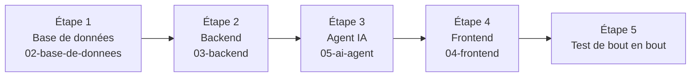

# Guide d'installation complet

Ce guide vous accompagne **de zéro jusqu'à une application qui tourne** : base de données, backend, agent IA, puis frontend. Pour chaque partie, il vous dit **quel fichier ouvrir**, **ce que vous faites**, **ce qu'il faut noter** et **comment vérifier** que tout fonctionne. Les explications détaillées sont dans le dossier de chaque partie.

- Vue d'ensemble du projet : [README.md](README.md)
- Comprendre comment les parties communiquent : [01-architecture-globale.md](01-architecture-globale.md)

## L'ordre à suivre



L'ordre est important : le backend a besoin de la base ; l'agent IA a besoin de la base **et** du backend ; le frontend a besoin du backend (et de l'agent pour le chatbot).

---

## 0. Avant de commencer

### Logiciels à installer

| Logiciel | Version | Pour quoi faire | Vérifier |
|---|---|---|---|
| **PostgreSQL** et **pgAdmin 4** | version récente | La base de données | pgAdmin s'ouvre et se connecte |
| **Python** | 3.11 ou 3.12 | Backend et agent IA | `python --version` |
| **Node.js** | 20.19 ou plus (ou 22.12+) | Frontend (exigé par Vite 8) | `node --version` |
| **Git** | récent *(facultatif)* | Récupérer le code | `git --version` |

### Comptes en ligne

| Compte | Pour quoi faire |
|---|---|
| **Groq** ([console.groq.com](https://console.groq.com)) | La clé d'API du modèle de langage de l'agent IA |
| **Gmail** | L'envoi des alertes et des e-mails de bienvenue (un « mot de passe d'application » est nécessaire) |

### Les trois dossiers de code

Récupérez les dossiers de code et rangez-les côte à côte, par exemple :

```
nextact/
├── nextact-backend-only/     ← le backend
├── ai-agent/                 ← l'agent IA
└── nextact-frontend-only/    ← le frontend
```

> Les fichiers `.env` (mots de passe, clés) ne sont **jamais** dans le code récupéré : vous les créez vous-même, aux étapes 2, 3 et 4.

### ✍️ Le carnet de configuration

Pendant l'installation, vous allez **choisir ou obtenir 11 valeurs**. **Notez-les au fur et à mesure** (feuille de papier ou gestionnaire de mots de passe) : chacune sera réutilisée dans un fichier `.env` ou pour vous connecter.

| N° | Valeur | Où l'obtenir | Où la réutiliser |
|:-:|---|---|---|
| 1 | Mot de passe du rôle `agent_user` | Vous le choisissez (étape 1) | `.env` de l'agent → `DB_PASS` |
| 2 | Mot de passe du rôle `backend_user` | Vous le choisissez (étape 1) | `.env` du backend → `DB_PASS` |
| 3 | E-mail du compte « AI agent » | Vous le choisissez (garder `agent@system.internal`) | `.env` de l'agent → `AGENT_SERVICE_EMAIL` |
| 4 | Mot de passe du compte « AI agent » | Vous le choisissez (étape 1) | `.env` de l'agent → `AGENT_SERVICE_PASSWORD` |
| 5 | Votre nom complet | Vous le choisissez (étape 1) | Affiché dans l'application |
| 6 | **Votre e-mail d'administrateur** | Vous le choisissez (étape 1) | **Connexion à l'application** |
| 7 | **Votre mot de passe d'administrateur** | Vous le choisissez (étape 1) | **Connexion à l'application** |
| 8 | Clé de signature des jetons (`SECRET_KEY`) | Vous la générez (étape 2) | `.env` du backend |
| 9 | Adresse Gmail d'envoi | Votre compte Gmail | `.env` du backend → `SMTP_USER` |
| 10 | Mot de passe d'application Gmail | Votre compte Google (étape 2) | `.env` du backend → `SMTP_PASSWORD` |
| 11 | Clé d'API Groq | Console Groq (étape 3) | `.env` de l'agent → `GROQ_API_KEY` |

> 🔒 Un fichier `.env` ne se publie jamais (GitHub, messagerie, capture d'écran). Ajoutez `.env` au `.gitignore` de chaque projet de code.

---

## Étape 1 — La base de données

📂 **Ouvrez** : [`02-base-de-donnees/README.md`](02-base-de-donnees/README.md), et gardez à côté le fichier [`install_database.sql`](02-base-de-donnees/install_database.sql).

**Ce que vous faites :**

1. Dans pgAdmin 4, créez la base **`nextact_ecom`**.
2. Ouvrez le fichier SQL dans un Query Tool lancé **sur cette base**.
3. Dans l'« ÉTAPE 0 » du fichier, saisissez **les valeurs n° 1 à 7** de votre carnet (c'est la seule partie à modifier).
4. Exécutez ensuite les étapes 1 à 8 du fichier, **une par une, dans l'ordre**.

**Vous obtenez** : les 17 tables de l'ERP, la table `users` avec deux comptes (administrateur et « AI agent », tous deux `ADMIN`), des données de démonstration, et le schéma `agent_reporting` (27 vues, 44 fonctions, 2 tables) avec les rôles `agent_user` et `backend_user`.

✅ **Vérification** (étape 8 du fichier SQL) : 27 vues, 44 fonctions, 2 comptes dans `users` ; et `agent_user` peut lire `agent_reporting.v_clients` mais **pas** `public.clients`.

---

## Étape 2 — Le backend

📂 **Ouvrez** : [`03-backend/configuration.md`](03-backend/configuration.md) (variables d'environnement et lancement), avec [`03-backend/README.md`](03-backend/README.md) pour la vue d'ensemble.

### 2.1 Environnement Python et bibliothèques

Dans un terminal, **à la racine du dossier du backend** :

```powershell
cd nextact-backend-only
python -m venv venv
venv\Scripts\activate
```

*(macOS / Linux : `source venv/bin/activate` à la place de la dernière ligne.)*

Avant d'installer, **ouvrez `requirements.txt` et supprimez la ligne `jose==1.0.0`** (c'est un autre paquet que `python-jose`, qui prend sa place). Puis :

```powershell
pip install -r requirements.txt
pip install pandas openpyxl reportlab "bcrypt==4.0.1"
```

> ⚠️ **`bcrypt==4.0.1` est important** : avec la version 5.x de `bcrypt`, la bibliothèque `passlib` échoue à la connexion (« password cannot be longer than 72 bytes »). Si `pip` refuse de lire `requirements.txt`, enregistrez-le en UTF-8 (dans VS Code : encodage en bas à droite → *Save with Encoding* → *UTF-8*).

### 2.2 Obtenir les valeurs n° 8, 9 et 10

**Valeur n° 8 — `SECRET_KEY`.** Générez une longue clé aléatoire :

```bash
python -c "import secrets; print(secrets.token_hex(32))"
```

Copiez le résultat (64 caractères) : c'est votre `SECRET_KEY`. **Ne la changez plus ensuite** : tous les utilisateurs seraient déconnectés.

**Valeurs n° 9 et 10 — Gmail.** Les alertes et l'e-mail de bienvenue passent par SMTP. Gmail n'accepte pas votre mot de passe habituel : il faut un **mot de passe d'application**.

1. Connectez-vous à votre compte Google et **activez la validation en 2 étapes** (*Sécurité → Validation en 2 étapes*) : sans elle, la page des mots de passe d'application n'apparaît pas.
2. Ouvrez directement **https://myaccount.google.com/apppasswords**.
3. Donnez un nom (par exemple `nextact`), puis cliquez sur **Créer**.
4. **Copiez le code de 16 caractères** affiché : c'est la valeur n° 10 (les espaces affichés par Google n'ont pas d'importance). Il n'est montré qu'une seule fois.

> ℹ️ Cette option est indisponible pour les comptes professionnels ou scolaires (Google Workspace), pour les comptes en protection avancée et si la validation en 2 étapes repose uniquement sur des clés de sécurité. Utilisez alors un compte Gmail personnel. Changer le mot de passe Google invalide tous les mots de passe d'application.

### 2.3 Créer le fichier `.env`

À la racine du backend, créez un fichier nommé exactement **`.env`** (avec le point) et collez-y ce modèle :

```dotenv
DB_HOST=localhost
DB_PORT=5432
DB_NAME=nextact_ecom
DB_USER=backend_user
DB_PASS=<valeur n°2>
SECRET_KEY=<valeur n°8>
ALGORITHM=HS256
ACCESS_TOKEN_EXPIRE_MINUTES=1440
SMTP_HOST=smtp.gmail.com
SMTP_PORT=587
SMTP_USER=<valeur n°9>
SMTP_PASSWORD=<valeur n°10>
SMTP_FROM_NAME=Nextact Alertes
ALERT_CHECK_INTERVAL_MINUTES=60
```

Remplacez chaque valeur entre `< >` (et supprimez les `< >`).

| Champ | Que mettre |
|---|---|
| `DB_HOST`, `DB_PORT` | `localhost` et `5432` si PostgreSQL est sur votre machine avec le port par défaut |
| `DB_NAME` | `nextact_ecom` |
| `DB_USER` | **`backend_user`** (jamais `postgres`, jamais `agent_user`) |
| `DB_PASS` | Le mot de passe de `backend_user` (valeur n° 2) |
| `SECRET_KEY` | La clé générée (valeur n° 8) |
| `ALGORITHM` | `HS256` |
| `ACCESS_TOKEN_EXPIRE_MINUTES` | Durée de vie d'une connexion, en **minutes**. `1440` = 24 h. Évitez les valeurs énormes : un jeton volé resterait valide très longtemps |
| `SMTP_HOST`, `SMTP_PORT` | `smtp.gmail.com` et `587` |
| `SMTP_USER` | Votre adresse Gmail (valeur n° 9) |
| `SMTP_PASSWORD` | Le mot de passe d'application (valeur n° 10) |
| `SMTP_FROM_NAME` | Le nom affiché comme expéditeur |
| `ALERT_CHECK_INTERVAL_MINUTES` | Toutes les combien de minutes le backend recherche des alertes (`60` par défaut) |

D'après la documentation du backend, les champs `DB_*`, `SECRET_KEY`, `ACCESS_TOKEN_EXPIRE_MINUTES`, `SMTP_HOST`, `SMTP_USER` et `SMTP_PASSWORD` sont **obligatoires** : le backend ne démarre pas sans eux. Les autres variables possibles sont décrites dans [`configuration.md`](03-backend/configuration.md). L'adresse de l'agent IA (`AGENT_API_URL`) vaut `http://localhost:8080` par défaut : **ne la modifiez pas** tant que l'agent tourne sur le port 8080.

### 2.4 Lancer et vérifier

Toujours à la racine du backend, environnement activé :

```powershell
uvicorn main:app --reload --port 8000
```

✅ **Vérifications :**

1. La console affiche une ligne du type `[Alertes] Scheduler démarré, intervalle = 60 min`.
2. **http://localhost:8000/docs** affiche la page interactive du backend (Swagger).
3. Testez la connexion : dans Swagger, ouvrez `POST /api/auth/login` → *Try it out* → corps :

```json
{ "email": "<valeur n°6>", "password": "<valeur n°7>" }
```

La réponse doit contenir un `access_token`. Refaites le même test avec l'e-mail et le mot de passe du compte « AI agent » (valeurs n° 3 et 4) : **les deux connexions doivent réussir**.

Laissez ce terminal ouvert.

---

## Étape 3 — L'agent IA

📂 **Ouvrez** : [`05-ai-agent/README.md`](05-ai-agent/README.md). Il détaille chaque champ du `.env` et la création de la clé Groq pas à pas.

**Ce que vous faites :**

1. Dans un **nouveau terminal**, créez un environnement virtuel dans `ai-agent/` et installez les bibliothèques (`pip install fastapi "uvicorn[standard]" python-dotenv httpx asyncpg groq sentence-transformers numpy pydantic`). Prévoyez quelques minutes : l'installation télécharge aussi PyTorch.
2. **Créez la clé Groq** (valeur n° 11) sur https://console.groq.com/keys : *Create API Key*, puis copiez-la immédiatement (elle ne s'affiche qu'une fois).
3. Créez le fichier **`.env` dans `ai-agent/`** (à côté du dossier `src/`, pas dedans) :

```dotenv
DB_HOST=localhost
DB_PORT=5432
DB_NAME=nextact_ecom
DB_USER=agent_user
DB_PASS=<valeur n°1>
GROQ_API_KEY=<valeur n°11>
BACKEND_URL=http://localhost:8000/api
AGENT_SERVICE_EMAIL=<valeur n°3>
AGENT_SERVICE_PASSWORD=<valeur n°4>
```

4. Testez la base : `cd src/db` puis `python conn-test.py` → « ✅ Connexion réussie ».
5. Lancez l'agent **depuis le dossier `src`** :

```powershell
cd ..
python main.py
```

Le premier lancement télécharge un petit modèle : il peut durer plusieurs minutes.

✅ **Vérification** : la console affiche `Uvicorn running on http://127.0.0.1:8080` et **http://127.0.0.1:8080/docs** s'affiche.

> 🎯 `DB_USER` est **`agent_user`**. Le compte « AI agent » (valeurs n° 3 et 4) a été créé à l'étape 1 avec **exactement** ces valeurs : elles doivent être identiques dans le `.env`.

Laissez ce terminal ouvert.

---

## Étape 4 — Le frontend

📂 **Ouvrez** : [`04-frontend/README.md`](04-frontend/README.md) (installation, scripts, déploiement).

**Ce que vous faites**, dans un **nouveau terminal** :

1. Vérifiez la version de Node : `node --version` doit afficher **20.19 ou plus** (ou 22.12 ou plus).
2. Installez les dépendances :

```powershell
cd nextact-frontend-only
npm install
```

3. Créez un fichier **`.env`** à la racine du frontend, contenant une seule ligne :

```dotenv
VITE_API_URL=http://localhost:8000/api
```

> ⚠️ Sous Windows, créez ce fichier **avec VS Code ou le Bloc-notes**, pas avec `echo ... > .env` dans PowerShell : cette commande peut produire un fichier dans un encodage que Vite ne lit pas. (La valeur ci-dessus est de toute façon l'adresse par défaut.)

4. Lancez le serveur de développement :

```powershell
npm run dev
```

✅ **Vérification** : ouvrez **http://localhost:5173**. La page de connexion s'affiche. Connectez-vous avec **votre e-mail et votre mot de passe d'administrateur** (valeurs n° 6 et 7).

> 🎯 Ouvrez bien l'adresse **`http://localhost:5173`** (pas `127.0.0.1`, pas un autre port) : le backend n'autorise que cette origine (CORS).
>
> 🐧 Sous Linux ou macOS (systèmes sensibles à la casse), le démarrage peut échouer car `App.jsx` importe `./pages/RefundsReport` alors que le fichier s'appelle `refundsReport.jsx` : renommez le fichier en `RefundsReport.jsx`. Sous Windows, ce problème n'apparaît pas.

---

## Étape 5 — Test de bout en bout

Une fois les trois services lancés (backend, agent, frontend), vérifiez le parcours complet :

- [ ] **Connexion** avec le compte administrateur : le **Dashboard** s'affiche.
- [ ] **Un rapport** (par exemple *Stock*) : choisissez une période qui contient **juillet 2026**. Les données de démonstration datent de cette période ; les indicateurs « du mois en cours » peuvent donc afficher 0.
- [ ] **Le chatbot** (bouton en bas à droite) : posez *« Quels produits sont en stock bas ? »*. Une réponse rédigée doit s'afficher.
- [ ] **Un export** : demandez *« Télécharge-moi les ventes de juillet 2026 en Excel »*. Un bouton **Télécharger le fichier** doit apparaître.
- [ ] **Les droits** : dans la page *Gestion des utilisateurs* (`/admin/users`), créez un utilisateur avec un rôle de domaine (par exemple `user_clients`) ; connectez-vous avec ce compte : seul son domaine est visible, et le chatbot refuse les questions sur les autres domaines (message « Selon tes permissions actuelles… »).

> 💡 La création d'un utilisateur envoie un e-mail de bienvenue avec un mot de passe temporaire : cela nécessite la configuration Gmail de l'étape 2. Le mot de passe temporaire est aussi renvoyé dans la réponse de l'API.

Si une étape échoue, consultez le **dépannage** ci-dessous.

---

## Lancer l'application au quotidien

Une fois tout installé, il suffit de démarrer les services **dans cet ordre**, chacun dans son terminal :

| Ordre | Service | Dossier | Commande | Adresse |
|:-:|---|---|---|---|
| 1 | PostgreSQL | — | Le service doit tourner (démarrage automatique en général) | `localhost:5432` |
| 2 | Backend | `nextact-backend-only/` | `venv\Scripts\activate` puis `uvicorn main:app --reload --port 8000` | http://localhost:8000/docs |
| 3 | Agent IA | `ai-agent/` | `venv\Scripts\activate`, puis `cd src`, puis `python main.py` | http://127.0.0.1:8080/docs |
| 4 | Frontend | `nextact-frontend-only/` | `npm run dev` | http://localhost:5173 |

Pour arrêter un service : **Ctrl + C** dans son terminal. Après toute modification d'un fichier `.env`, **redémarrez** le service concerné.

---

## Dépannage

| Symptôme | Cause probable | Solution |
|---|---|---|
| Backend : erreur de validation, champ « Field required » au démarrage | Variable obligatoire absente du `.env` | Complétez le `.env` du backend (voir §2.3) |
| Backend : `ValueError: password cannot be longer than 72 bytes` à la connexion | `bcrypt` 5.x incompatible avec `passlib` | `pip install "bcrypt==4.0.1"` puis relancez |
| Backend : `pip` refuse `requirements.txt` | Fichier encodé en UTF-16 | Réenregistrez-le en UTF-8 ; supprimez la ligne `jose==1.0.0` |
| Backend : `ModuleNotFoundError: pandas` (ou `openpyxl`, `reportlab`) | Bibliothèques absentes de `requirements.txt` | `pip install pandas openpyxl reportlab` |
| Connexion à la base refusée (`password authentication failed`) | `DB_PASS` différent du mot de passe choisi à l'étape 1 | Corrigez le `.env`, ou `ALTER ROLE backend_user WITH PASSWORD '...';` dans pgAdmin |
| Login impossible dans l'application (identifiants refusés) | E-mail ou mot de passe différent des valeurs n° 6 et 7 | Reprenez les valeurs de l'étape 0 du SQL |
| Navigateur : erreur « blocked by CORS policy » | Frontend ouvert ailleurs que sur `http://localhost:5173` (autre port ou `127.0.0.1`) | Ouvrez exactement `http://localhost:5173`. Si Vite a pris un autre port car 5173 était occupé, libérez le port 5173 |
| Chatbot : « Je n'ai pas pu contacter le serveur » | Backend ou agent IA arrêté | Vérifiez que `/docs` s'affiche sur les ports 8000 et 8080 |
| Chatbot : erreur 502 | L'agent IA est injoignable depuis le backend | Lancez l'agent ; vérifiez qu'il écoute sur le port 8080 |
| Agent : `KeyError: 'GROQ_API_KEY'` | `.env` manquant ou mal placé | Il doit être dans `ai-agent/`, à côté de `src/` |
| Agent : réponse 500 citant Groq | Clé erronée, quota dépassé ou modèle indisponible | Lisez le message du terminal ; vérifiez la clé et les limites sur la console Groq |
| Agent : « Erreur backend » ou connexion du compte de service refusée | Valeurs n° 3 et 4 différentes de celles du SQL, ou backend arrêté | Vérifiez le `.env` de l'agent et le test de connexion du compte « AI agent » (§2.4) |
| Frontend : le démarrage échoue, message sur la version de Node | Node trop ancien | Installez Node 20.19 ou plus (ou 22.12+) |
| Frontend (Linux/macOS) : `Could not resolve ./pages/RefundsReport` | Casse du nom de fichier | Renommez `refundsReport.jsx` en `RefundsReport.jsx` |
| Dashboard et rapports vides | Période sans données | Choisissez une période contenant juillet 2026 (données de démonstration) |
| E-mails non reçus | Mot de passe d'application invalide, ou compte non éligible | Recréez le mot de passe d'application (§2.2) ; un compte Google Workspace n'en propose pas |
| `Address already in use` | Port 8000, 8080 ou 5173 déjà utilisé | Fermez l'autre programme ou l'ancienne instance du service |
| Une modification du `.env` n'a aucun effet | Service non redémarré | Arrêtez-le (Ctrl + C) et relancez-le |

---

## ✅ Check-list finale

- [ ] Les 11 valeurs du carnet de configuration sont notées
- [ ] **Base** : 27 vues, 44 fonctions, 2 comptes `ADMIN` dans `users`
- [ ] **Backend** : `/docs` s'affiche, la connexion de l'administrateur **et** celle du compte « AI agent » fonctionnent
- [ ] **Agent IA** : `http://127.0.0.1:8080/docs` s'affiche
- [ ] **Frontend** : connexion réussie sur `http://localhost:5173`
- [ ] **Chatbot** : une question simple reçoit une réponse ; un export propose un lien de téléchargement
- [ ] Aucun fichier `.env` n'est dans un dépôt Git

## Pour aller plus loin

| Je veux… | Je lis… |
|---|---|
| Comprendre l'ensemble du projet | [01-architecture-globale.md](01-architecture-globale.md) |
| Connaître une table, une vue ou une fonction | [`02-base-de-donnees/`](02-base-de-donnees/README.md) |
| Connaître les routes de l'API | [`03-backend/routes-api.md`](03-backend/routes-api.md) |
| Comprendre une page de l'interface | [`04-frontend/pages-et-composants.md`](04-frontend/pages-et-composants.md) |
| Comprendre comment l'agent raisonne et ses protections | [`05-ai-agent/`](05-ai-agent/README.md) |
